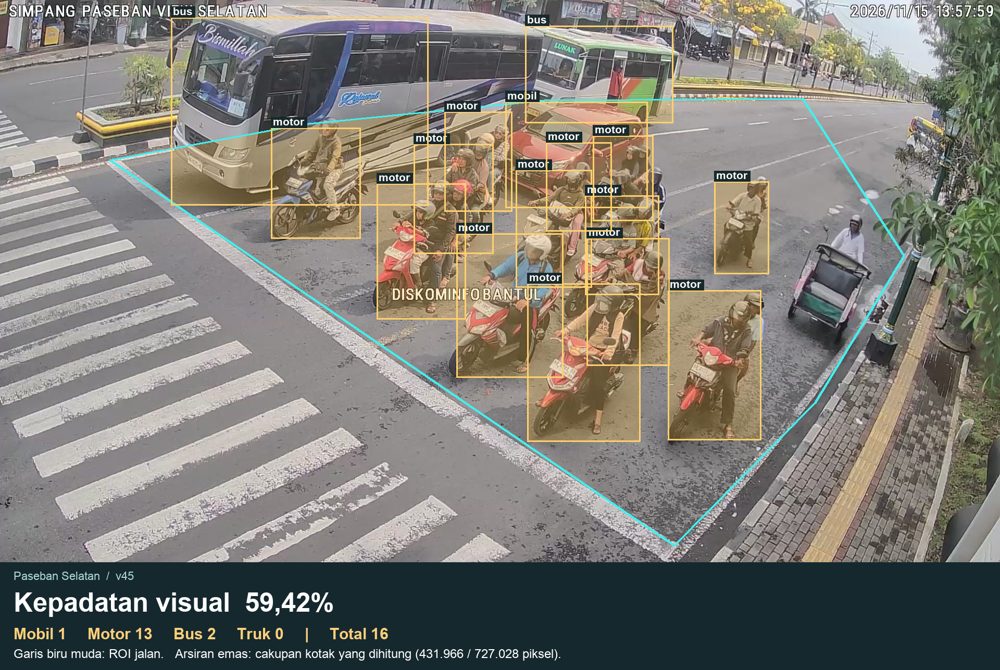

# Penghitungan kendaraan dan kepadatan visual CCTV Bantul

Dari satu foto persimpangan, demo v45 menghitung mobil, motor, bus, dan truk. Persentase kepadatan visual menunjukkan berapa bagian area jalan yang tertutup gabungan kotak kendaraan. Model memakai pengolahan citra klasik dan machine learning tanpa deep learning.

**Coba di Mac Apple Silicon.** Ambil `PoC_Bantul_v45_macOS_arm64.zip` dari [halaman Releases](https://github.com/hanafishiddiq/tugas-akhir-pcd/releases), ekstrak, lalu buka `Jalankan.command`. Python, pustaka, bobot, dan empat foto contoh sudah ada di dalam paket. Terminal menampilkan lokasi gambar beranotasi (`hasil.jpg`), rincian angka (`hasil.json`), dan masker piksel (`cakupan.png`).



Pada S033, demo menghitung **1 mobil, 13 motor, 2 bus, dan 0 truk**. Kotaknya menutupi 431.966 dari 727.028 piksel area jalan, sehingga cakupannya **59,42%**. Foto berasal dari CCTV Pemerintah Kabupaten Bantul / Diskominfo Bantul, kamera Paseban Selatan. Tim menambahkan ROI, kotak, label dan ringkasan. [Sumber dan atribusi gambar](docs/rilis-v45/README.md#sumber-gambar)

## Gunakan foto sendiri

Dari Terminal di dalam folder hasil ekstraksi, jalankan perintah berikut. Contoh ini memakai foto Bejen bawaan melalui jalur masukan foto biasa.

```sh
./Jalankan.command --foto contoh/NB006.jpg --kamera 04_bejen_barat
```

Ganti jalur foto dengan berkas JPG atau PNG dan pilih kamera asalnya. Tiga pilihan kamera adalah `01_paseban_selatan`, `02_paseban_barat`, dan `04_bejen_barat`. Pertahankan resolusi serta sudut kamera asli agar poligon jalan sesuai. Untuk membandingkan ulang keempat contoh dengan keluaran beku, jalankan `./Jalankan.command --uji`. [Panduan contoh, checksum, dan menjalankan kode dari clone](docs/rilis-v45/README.md)

## Seberapa dekat hasilnya dengan anotasi?

| Ukuran | Hasil v45 | Data penilaian |
|---|---:|---|
| Macro-F1 deteksi empat kelas, validasi | 85,50% | 61 gambar untuk memilih model |
| Macro-F1 deteksi empat kelas, uji | 59,11% | 76 gambar uji dari 55 kelompok |
| Galat absolut rata-rata jumlah total | 0,45 kendaraan per gambar | 31 gambar uji beracuan lengkap |
| Galat absolut rata-rata cakupan | 3,32 poin persentase | 31 gambar uji beracuan lengkap |

Pada uji resmi, model menemukan 3 dari 8 bus dan 2 dari 6 truk acuan. Waktu median inferensi adalah 8,10 detik per gambar pada mesin uji. Evaluasi memakai sesi dari tiga kamera yang sama. [Hasil per kelas, contoh kesalahan, dan batas penerapan](evaluasi/README.md)

## Berkas proyek

- **Demo dan model.** Kode inferensi, poligon ROI dan pemeriksa empat contoh tersedia bersama di [src/v45](src/v45/). Bobot beku didistribusikan bersama ZIP rilis.
- **Dataset.** Pembagian terkunci memakai 99 gambar training, 61 validasi, dan 76 uji. Data pilot juga mencatat 10 embargo dan 2 karantina. [Kartu dataset dan protokol](data/bantul-pilot-v1/README.md) · [Foto serta overlay di Google Drive](https://drive.google.com/drive/folders/1dL_hXMOnOQvsBkwFW4IsZBJYo-ulJcR5)
- **Paper IEEE.** Baca [draf PDF](paper/paper.pdf) atau sunting [sumber LaTeX](paper/paper.tex). Dari folder `paper`, kompilasi dengan `tectonic paper.tex`.
