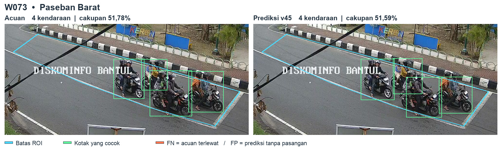
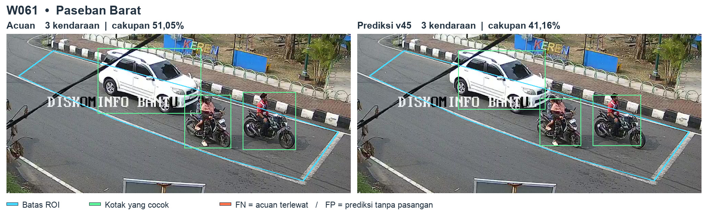
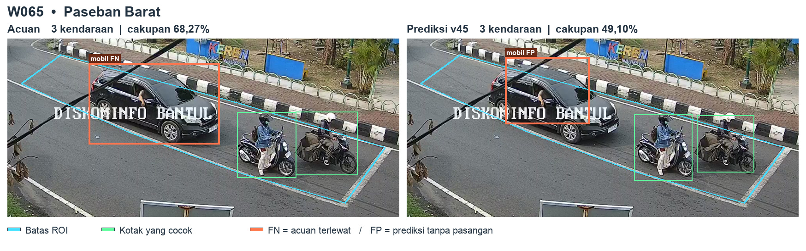
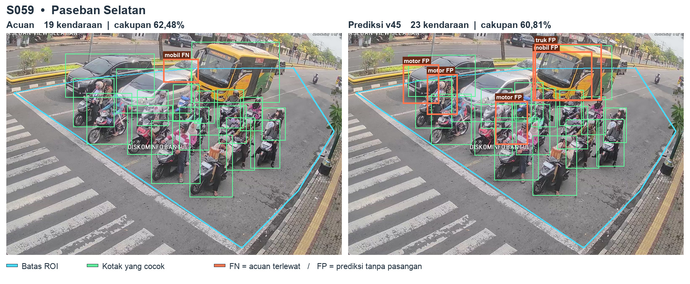

# Evaluasi akhir penghitungan kendaraan dan kepadatan visual pada citra CCTV

Pada tiga kamera Bantul, model klasik v45 memperkirakan jumlah total kendaraan dengan galat absolut rata-rata 0,45 kendaraan per gambar dan cakupan jalan dengan galat 3,32 poin persentase. Kedua ukuran memenuhi target PoC. Kemampuan mengenali tiap jenis kendaraan lebih bervariasi. Mobil dan motor mencapai F1 di atas 83%, sedangkan lima dari delapan bus dan empat dari enam truk acuan terlewat.

## Deteksi pada 76 gambar uji

Model dipilih menggunakan 61 gambar validasi dengan macro-F1 85,50%, kemudian dibekukan. Uji pada 76 gambar dari 55 kelompok adegan menghasilkan macro-F1 59,11%. Sebuah deteksi dinilai benar jika kelas cocok dan perbandingan luas irisan terhadap gabungan dua kotak (IoU) mencapai 0,50 dalam pencocokan satu lawan satu. Seluruh 76 gambar berkontribusi pada evaluasi deteksi. Pada 45 gambar beranotasi parsial, evaluator mengikuti aturan area ambigu dan hanya menilai objek yang memiliki acuan sesuai protokol.

| Jenis kendaraan | Objek acuan | Presisi (%) | Recall (%) | F1 (%) |
|---|---:|---:|---:|---:|
| Mobil | 148 | 84,42 | 87,84 | 86,09 |
| Motor | 439 | 85,75 | 82,23 | 83,95 |
| Bus | 8 | 50,00 | 37,50 | 42,86 |
| Truk | 6 | 18,18 | 33,33 | 23,53 |

Macro-F1 memberi bobot yang sama pada keempat kelas. Micro-F1 mencapai 83,15% ketika seluruh deteksi digabungkan, dengan 587 dari 601 objek acuan berupa mobil atau motor. Interval bootstrap 95% untuk macro-F1 berada pada 45,81–66,30% berdasarkan 2.000 pengambilan ulang kelompok. Dukungan kelas berat yang kecil membatasi ketepatan estimasi.

## Hitungan dan cakupan pada 31 gambar beracuan lengkap

Kepadatan visual menyatakan persentase piksel ROI jalan yang tertutup gabungan kotak kendaraan yang diterima. Setiap kotak dipotong pada batas ROI. Piksel yang tercakup beberapa kotak dihitung sekali. Perhitungan yang sama diterapkan pada kotak acuan dan prediksi. MAE adalah rerata selisih absolut per gambar.

| Kamera | Gambar lengkap | Total tepat | MAE jumlah (kendaraan) | MAE cakupan (poin persentase) |
|---|---:|---:|---:|---:|
| Paseban Selatan | 12 | 8 | 0,67 | 1,86 |
| Paseban Barat | 11 | 8 | 0,27 | 6,63 |
| Bejen Barat | 8 | 6 | 0,38 | 0,93 |
| Gabungan | 31 | 22 | 0,45 | 3,32 |

Sebanyak 21 gambar memiliki hitungan tepat untuk keempat kelas sekaligus. Kelima ROI kosong diprediksi kosong. Pada 26 ROI berisi, MAE naik menjadi 0,54 kendaraan dan 3,95 poin persentase. Cakupan berada di bawah acuan pada 23 gambar, di atas acuan pada tiga gambar, dan tepat pada lima gambar kosong. Rata-rata selisih bertanda sebesar −3,21 poin persentase.

<!-- pagebreak -->
## Dampak ukuran kotak terhadap kepadatan

Di antara gambar berisi yang seluruh deteksinya cocok, W073 memiliki selisih absolut cakupan terkecil dan W061 memiliki selisih terbesar. Kedua gambar berasal dari Paseban Barat. Panel kiri menunjukkan anotasi acuan, sedangkan panel kanan menunjukkan keluaran v45 dengan bidang pandang yang sama. Panel diperbesar di sekitar ROI agar batas kotak terbaca.

Gambar 1. Keempat motor pada W073 memiliki pasangan yang benar. Cakupan v45 sebesar 51,59% mendekati acuan 51,78%. Ada 2.853 piksel yang hanya tercakup oleh kotak acuan dan 2.598 piksel yang hanya tercakup oleh kotak prediksi. Perbedaan bersihnya hanya 255 piksel.

Gambar 2. Pada W061, satu mobil dan dua motor semuanya terdeteksi dengan kelas benar. Ketiga kotak prediksi lebih kecil daripada pasangan acuannya. Model menghasilkan cakupan 41,16% terhadap acuan 51,05%, selisih −9,88 poin persentase bila dihitung sebelum pembulatan. Hitungan kendaraan yang tepat masih dapat disertai kesalahan cakupan yang besar.

## Waktu proses per gambar

| Kamera | Gambar uji | Rerata (detik) | Median (detik) | P90 (detik) |
|---|---:|---:|---:|---:|
| Paseban Selatan | 32 | 19,71 | 17,98 | 25,61 |
| Paseban Barat | 18 | 8,06 | 7,13 | 12,16 |
| Bejen Barat | 26 | 4,66 | 4,22 | 6,60 |
| Gabungan | 76 | 11,80 | 8,10 | 20,94 |

Waktu tercatat berkisar 1,94–50,60 detik pada macOS arm64 dengan batas satu thread untuk OpenCV dan pustaka numerik. Pengukur waktu dimulai setelah gambar RGB dan model tersedia, lalu mencakup deteksi, salinan hasil pembanding pada uji berpasangan, koreksi kotak, verifikasi kandidat, dan perhitungan cakupan. Waktu memuat model, membaca berkas, menggambar overlay, serta menulis hasil berada di luar pengukuran. P90 adalah persentil ke-90 dari waktu yang tercatat.

<!-- pagebreak -->
## Kesalahan lokasi dan hitungan pada antrean

W065 menunjukkan galat cakupan terbesar di antara 31 gambar lengkap. S059 menunjukkan galat hitungan total terbesar. Keduanya dipilih sesudah evaluasi untuk menjelaskan hasil pengukuran.

Gambar 3. Pada W065, acuan dan v45 sama-sama mencatat satu mobil dan dua motor. Kotak mobil hanya menutupi sebagian badan kendaraan, dengan IoU 0,463 terhadap kotak acuan. Pada ambang 0,50, satu prediksi tercatat berlebih dan satu mobil acuan tercatat terlewat. Cakupan turun dari 68,27% menjadi 49,10%, selisih −19,17 poin persentase.

Gambar 4. Pada S059, v45 menghitung 23 kendaraan terhadap 19 kendaraan acuan. Tiga prediksi motor, satu mobil, dan satu truk berlebih, sementara satu mobil acuan terlewat. Dari 121.518 piksel ROI dalam gabungan lima kotak berlebih, hanya 3.844 piksel berada di luar kotak deteksi yang cocok. Tumpang tindih ini menjelaskan mengapa model menghitung empat kendaraan terlalu banyak sementara cakupan prediksi 60,81% tetap dekat dengan acuan 62,48%.

## Batas penerapan PoC

Secara gabungan, MAE hitungan dan cakupan memenuhi target yang dibekukan, yaitu paling banyak satu kendaraan dan lima poin persentase. Target deteksi berupa macro-F1 minimal 85% dan F1 tiap kelas minimal 75% belum tercapai. Paseban Barat sendiri mencatat MAE cakupan 6,63 poin persentase. Empat dari 22 gambar yang totalnya tepat masih mengandung deteksi berlebih sekaligus objek terlewat.

Evaluasi memakai pemisahan waktu pada tiga kamera yang dikenal model serta anotasi yang diaudit dengan bantuan AI. Hasil menggambarkan kinerja pada cakupan tersebut. Estimasi kepadatan mengukur luasan kotak pada bidang citra. Pengukuran okupansi fisik, penerapan pada kamera baru, dan penetapan kategori rendah, sedang, atau tinggi memerlukan acuan tersendiri.

## Tabel evaluasi

[Deteksi per kelas](deteksi_per_kelas.csv) · [Hitungan dan cakupan per kamera](hitungan_dan_cakupan.csv) · [Perbandingan tiap gambar](perbandingan_31.csv) · [Ringkasan waktu](ringkasan_waktu.csv) · [Waktu per gambar](waktu_76.csv) · [Atribusi panel gambar](../docs/rilis-v45/README.md#sumber-gambar).
